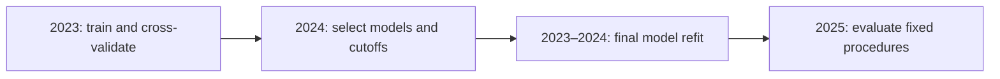
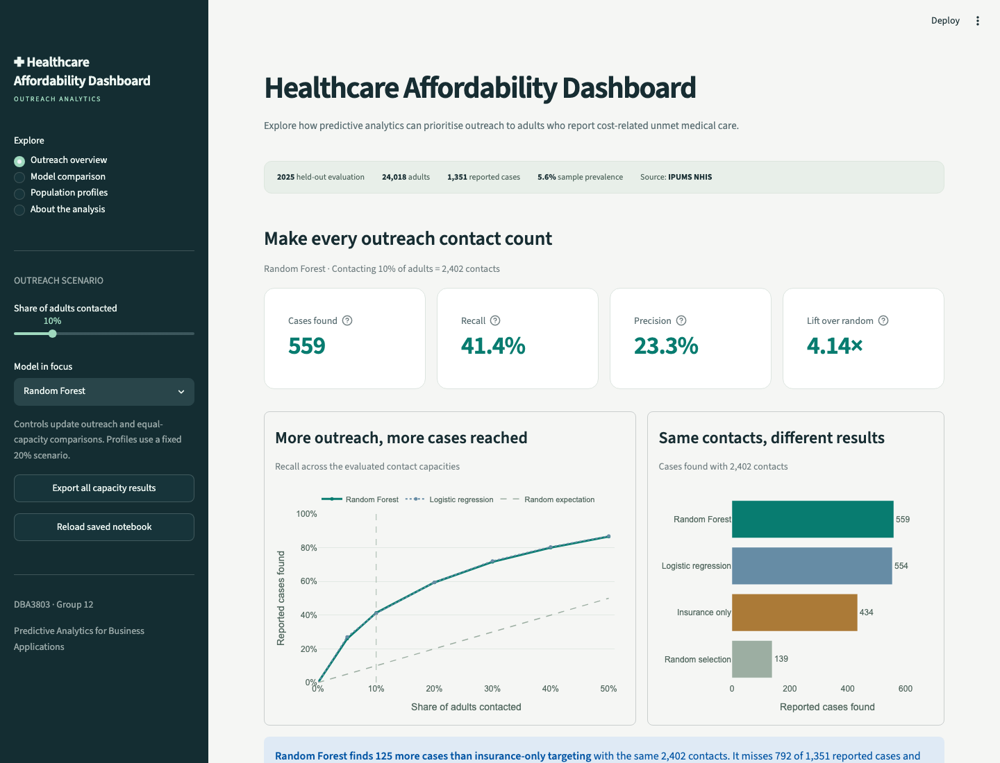

# Prioritising Healthcare Affordability Outreach

**DBA3803 · Group 12**  
Predictive Analytics for Business Applications

Using survey data to prioritise affordability-related outreach, compare predictive models and understand the people on a contact list.

[Main notebook](DBA3803_RFModel.ipynb) · [Key findings](#key-findings) · [Run locally](#run-locally) · [Dashboard](#streamlit-dashboard)

> **Business question:** Given limited outreach capacity, can a U.S. healthcare provider identify adults reporting cost-related unmet medical care more effectively than random or insurance-only targeting, and what profiles exist among those prioritised?

## Project overview

Healthcare providers have limited staff for financial-assistance and care-navigation outreach. Insurance status is useful, but covered adults can also experience cost barriers. This project tests whether combining financial circumstances, health, demographics and access-to-care characteristics improves prioritisation.

The project has two objectives:

1. **Prioritise outreach:** compare Random Forest, full-feature logistic regression and simpler targeting methods at the same contact capacity.
2. **Understand the priority population:** describe groups with similar characteristics to inform possible follow-up questions and support pathways.

The outcome is **self-reported medical care needed but not received because of cost during the previous 12 months**, measured by `YBARCARE`. Predictions support an assessment of current needs; they do not establish future care needs, financial-assistance eligibility or the benefit of an intervention. See the [IPUMS outcome definition](https://nhis.ipums.org/nhis-action/variables/YBARCARE).

## Key findings

The following figures describe the notebook's **current saved 2025 evaluation**, containing **24,018 adults** and **1,351 reported cases**. They are unweighted sample results.

### More cases found with the same contact capacity

At an illustrative **10% capacity**, every method contacts **2,402 adults**.

| Method | Cases found | Cases missed | Precision | Recall |
|---|---:|---:|---:|---:|
| **Random Forest** | **559** | **792** | **23.3%** | **41.4%** |
| Full-feature logistic regression | 554 | 797 | 23.1% | 41.0% |
| Insurance-only targeting | 434 | 917 | 18.1% | 32.1% |
| Random selection: fixed tie order | 139 | 1,212 | 5.8% | 10.3% |

Random Forest identifies **125 more reported cases than insurance-only targeting** with the same workload. Its case yield is **4.14 times random expectation**. Random selection would find approximately **135 cases on average**; the fixed random ordering used in this sample happens to find 139.

**Random Forest does not clearly outperform logistic regression overall.** Its advantage at 10% capacity is five cases. Logistic regression has slightly higher average precision (0.2362 versus 0.2267), slightly higher ROC AUC (0.7967 versus 0.7919) and lower Brier probability error (0.0479 versus 0.1517). Small differences have not been shown to be statistically meaningful.

### Broader outreach reaches more cases, with more follow-up

Each model also has a separate score cutoff selected on 2024 to maximise F2, which gives recall greater emphasis than precision.

| Frozen F2 rule | Cutoff | Adults flagged | Cases found | Cases missed | False positives | Recall | F2 |
|---|---:|---:|---:|---:|---:|---:|---:|
| Random Forest | 0.460557 | 6,593 | 918 | 433 | 5,675 | 67.9% | 0.3826 |
| Full-feature logistic regression | 0.058811 | 7,613 | 994 | 357 | 6,619 | 73.6% | 0.3818 |

Compared with the forest’s 10% list, its F2 rule finds **359 additional cases** through **4,191 additional contacts**, including **3,832 additional false positives**.

These lists have **different contact counts**. They illustrate the trade-off between case finding and workload; they are separate from the equal-capacity comparison above. F2 is an analytical preference, not proof of an economically optimal outreach budget.

<details>
<summary>How to read the metrics</summary>

| Metric | Meaning |
|---|---|
| Recall | Share of all reported cases found in the contact list |
| Precision | Share of contacted adults who reported the outcome |
| Lift | Case yield divided by the expected random-selection yield; 1 means random expectation |
| Average precision (AP) | Summary of precision–recall ranking performance; higher is better |
| ROC AUC | Ability to rank cases above non-cases; higher is better |
| F2 | Precision–recall summary that gives recall greater emphasis |
| Brier score | Squared probability error; lower is better |

AP, ROC AUC and F2 are not classification accuracy. A model score is not automatically a calibrated individual probability.

</details>

### Two profiles within the priority population

K-prototypes clustering describes the Random Forest's **highest-ranked 20% in 2025**, a pool of **4,804 adults**. Profiles were developed on 2024 and applied unchanged to 2025.

| Characteristic | Profile A | Profile B |
|---|---:|---:|
| Adults | 2,721 | 2,083 |
| Share of the priority pool | 56.6% | 43.4% |
| Median age | 34 | 57 |
| Uninsured | 39.1% | 25.2% |
| Income below twice the poverty threshold | 40.9% | 51.5% |
| Fair or poor health | 19.4% | 54.6% |

Profile A is younger, with comparatively more coverage and usual-care gaps. Profile B is older, with comparatively more poor health and low income. These patterns suggest different starting questions during outreach, rather than verified individual needs or proven support programmes.

Characteristic percentages use **all adults in each profile** as the denominator. Missing responses remain in that denominator but do not count as having the characteristic.

## Data

The supplied files are extracts of the [IPUMS National Health Interview Survey](https://nhis.ipums.org/nhis-action/variables/YBARCARE). After cleaning, one row represents a sample adult with a valid target answer and a positive survey weight.

| Sample year | Adults after cleaning | Reported cases | Role |
|---|---:|---:|---|
| 2023 | 29,276 | 1,716 | Initial training and five-fold cross-validation |
| 2024 | 32,354 | 2,195 | Model/cutoff selection, diagnostics and profiling |
| 2025 | 24,018 | 1,351 | Later-year evaluation |

Keep both CSV files beside the main notebook:

- `nhis_2023_2024.csv`: development data, with 61,630 retained adults across both years.
- `nhis_2025.csv`: evaluation data.

**Ten predictors:** region, age, sex, race/ethnicity, education, employment, income relative to poverty, self-rated health, usual source of care and insurance coverage.

Record identifiers, year, sample flags and survey-design fields are excluded from model inputs. The target is recoded from `1 = No` / `2 = Yes` into `0 = No` / `1 = Yes`. Documented non-response codes are treated as missing; missing predictors are retained for pipeline-based handling.

Survey weights support the notebook's population-oriented descriptive summaries. **Model fitting, contact counts and predictive-performance metrics are unweighted.**

## Analytical workflow



| Stage | What the notebook does |
|---|---|
| Inspect and clean | Check structure and record IDs, select sample adults, recode the target and handle non-response codes |
| Explore | Examine survey-weighted associations using development data |
| Develop the forest | Compare one-hot, ordered and hybrid representations; screen settings using 2023 CV average precision and select using 2024 F2 |
| Develop the logistic benchmark | Use the same ten inputs and CV folds; test linear age, curved age and insurance interactions with regularisation |
| Diagnose | Inspect ranking, calibration, permutation importance and subgroup coverage |
| Describe profiles | Compare 2–5 K-prototypes solutions within the 2024 priority pool and fix the selected profiles |
| Evaluate | Apply the fixed procedures to 2025 at equal capacities and separate frozen cutoffs |
| Recommend | Connect case finding, contact workload, uncertainty and possible follow-up approaches |

**Selected forest:** the saved run retains **Original forest reference**, a one-hot model with numeric age. It ties One-hot finalist 1 on 2024 F2 (**0.3986**) and is retained by the assigned tie-break priority. Its reference-row `CV_AP` is intentionally not recorded. Existing output labels such as “Revised forest” refer to the selected procedure; in this run that is the original reference, so their F2 results are identical.

**Parts 6.3 and 8.3 serve different purposes:** 6.3 develops and fixes the logistic benchmark using 2023–2024; 8.3 evaluates it against the forest on 2025. No model is retrained by the dashboard.

## Run locally

Run commands from the repository root. The current saved notebook execution uses **Python 3.14.7**; use a Python version compatible with the pinned packages.

### 1. Set up the notebook environment

```bash
python -m venv .venv
source .venv/bin/activate
python -m pip install -r requirements.txt
```

<details>
<summary>Windows PowerShell activation</summary>

Replace the activation command above with:

```powershell
.venv\Scripts\Activate.ps1
```

</details>

### 2. Run the notebook

1. Open the repository in VS Code with the **Python** and **Jupyter** extensions.
2. Open [DBA3803_RFModel.ipynb](DBA3803_RFModel.ipynb).
3. Select the Python kernel from `.venv`.
4. Confirm that both CSV files are in the repository root.
5. **Restart Kernel → Run All**, then save the completed notebook.

The modelling cells depend on earlier preparation and fitting cells. Run the complete notebook in order; Part 8.3 cannot run by itself in a fresh kernel. Installing a package in one Python environment does not make it available in a different notebook kernel.

## Streamlit dashboard

The **Healthcare Affordability Dashboard** reads saved notebook results and provides four views:

- **Outreach overview:** capacity/model controls, case counts, recall, precision, lift and interactive charts.
- **Model comparison:** equal-capacity comparisons, frozen F2 rules, predictor importance and overall metrics.
- **Population profiles:** the two profiles in the fixed 20% Random Forest scenario.
- **About the analysis:** evaluation design, limitations, weighted prevalence and source consistency checks.



### Launch the dashboard

Dashboard dependencies are listed separately. To keep them separate from the notebook environment, use a second environment:

```bash
python -m venv .venv-dashboard
source .venv-dashboard/bin/activate
python -m pip install -r dashboard/requirements.txt
python -m streamlit run dashboard/app.py
```

On Windows, use `.venv-dashboard\Scripts\Activate.ps1` for activation.

Open **http://localhost:8501** if the browser does not open automatically. Keep the terminal running; press **Ctrl+C** to stop the app.

After saving the notebook, click **Reload saved notebook** or refresh the app. The reader reconciles counts and displayed metrics, checks that evaluation tables agree and requires the benchmark consistency checks to pass. It reads the saved results without executing notebook cells. The sidebar also exports all capacity results as CSV.

**Current saved-file status:** the execution counters are **34, 2–33**. The dashboard can display these consistent saved results and discloses the out-of-order counters under **About the analysis → Source and consistency checks**. This does not verify a clean sequential run; missing execution records, saved errors and inconsistent results still block loading.

The profile view always describes the **20% Random Forest scenario**, independently of the sidebar controls. The dashboard reads aggregate outputs; it does not retrain models or edit the notebook. See the [dashboard guide](dashboard/README.md) for more detail.

## Repository guide

```text
DBA3803-Grp12/
├── DBA3803_RFModel.ipynb       # Main analysis and saved results
├── code.ipynb                  # Supporting data preparation and EDA
├── nhis_2023_2024.csv           # Development extract
├── nhis_2025.csv                # Evaluation extract
├── requirements.txt            # Notebook dependencies
├── .streamlit/
│   └── config.toml              # Dashboard theme and settings
├── dashboard/
│   ├── app.py                  # Streamlit interface
│   ├── notebook_data.py        # Saved-result reader and consistency checks
│   ├── requirements.txt        # Dashboard dependencies
│   └── README.md               # Dashboard instructions
└── docs/images/
    └── dashboard-preview.png   # Dashboard screenshot
```

## Interpretation and limitations

- **Target:** the outcome is a past-year, self-reported cost barrier. It is not a future diagnosis or an eligibility decision.
- **Scores:** the forest's calibration plot shows scores above observed rates. Use them for ranking rather than as calibrated personal probabilities.
- **Model comparison:** logistic regression is a serious alternative. The small differences shown do not establish statistically significant superiority.
- **Group coverage:** overall metrics conceal subgroup differences. These diagnostics are descriptive, not a complete fairness assessment.
- **External validity:** survey respondents and a provider's patients can differ. Validate with the intended population before routine use.
- **Evaluation history:** 2025 is excluded from fitting and tuning in this workflow, but it was examined during earlier project work. Further independent confirmation is needed.
- **Business impact:** no contact-cost or intervention-effect analysis establishes an optimal budget, financial savings or improved health outcomes.

The practical next step is a **provider-specific validation and outreach pilot**: set a feasible contact limit, assess current needs, compare both models, and monitor workload, participation, group coverage and support outcomes.

Results here are a snapshot of the current saved notebook. Review the tables and dashboard preview if the analysis or inputs change.

## Use of AI

Generative AI tools, including ChatGPT and Codex, were used extensively to generate and revise analysis code, debug errors, develop the dashboard, draft notebook explanations and project documentation, and help interpret results.

Numerical results reported in this README and the dashboard are taken from the notebook's saved outputs. The team is responsible for reviewing AI-generated material, understanding the code and methods, and checking the conclusions in the final submission.

## References

- [IPUMS NHIS: outcome definition and survey weights](https://nhis.ipums.org/nhis-action/variables/YBARCARE)
- [IPUMS NHIS: insurance coverage](https://nhis.ipums.org/nhis-action/variables/HINOTCOVE)
- [IPUMS NHIS: income relative to poverty](https://nhis.ipums.org/nhis-action/variables/POVERTY)
- [Scikit-learn: Random Forest classifier](https://scikit-learn.org/stable/modules/generated/sklearn.ensemble.RandomForestClassifier.html)
- [Scikit-learn: logistic regression](https://scikit-learn.org/stable/modules/generated/sklearn.linear_model.LogisticRegression.html)
- [K-prototypes implementation](https://github.com/nicodv/kmodes)

Variable definitions and further references are provided in the notebook appendix.
